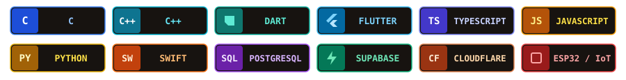

  

  

  
  
  

  
  
  

  

### 🚀 Featured Software & Live Interactive Deployments

<table>
  <tr>
    <td width="50%" valign="top">
      <h3>🔭 <a href="https://spherex-lens.pages.dev/">SPHEREx Lens</a></h3>
      
<strong>NASA Space Apps Challenge 2026</strong>

      
Public near-infrared sky explorer built on real <strong>NASA/JPL SPHEREx DR1</strong> data from IRSA. Decodes raw scientific <strong>FITS</strong> binary tables (<code>IMAGE</code>, <code>FLAGS</code>, <code>VARIA</code>, <code>ZODI</code>, <code>EPSF</code>, <code>WAVE</code>) into multi-epoch sky imagery with frame subtraction, cosmic-ray flag filtering, and a <strong>LIFO request queue + MVVM + TDD</strong> frontend.

      

        
      

    </td>
    <td width="50%" valign="top">
      <h3>🗄️ <a href="https://apresentacao-sql.pages.dev/">SQL Under the Hood</a></h3>
      
<strong>Interactive Relational Engine Visualizer</strong>

      
Explore how database storage engines work beneath SQL queries—interactive step-throughs of query execution pipelines, <strong>LRU buffer pools</strong>, <strong>8 KB slotted pages</strong>, null bitmaps, and <strong>SIMD</strong> vectorized execution (bilingual EN / PT-BR).

      

        
      

    </td>
  </tr>
  <tr>
    <td width="50%" valign="top">
      <h3>📡 <a href="https://armageddon-vox.pages.dev/">Armageddon Vox</a></h3>
      
<strong>3-Tier Web Suite & Async Multi-Channel AI Broker</strong>

      
Zero-framework <strong>JavaScript</strong> tactical simulator paired with a <strong>Supabase (PostgreSQL + RLS)</strong> message queue, a local <strong>Node.js + Playwright</strong> multi-LLM daemon, procedural <strong>Web Audio API</strong> synthesis, and <strong>392 automated tests</strong>.

      

        
      

    </td>
    <td width="50%" valign="top">
      <h3>🧗 <a href="https://github.com/aresta-climb/aresta_app">Aresta Climb</a></h3>
      
<strong>Lead Frontend Developer • Production Mobile App</strong>

      
Offline-first climbing guide built with <strong>Flutter/Dart</strong> & <strong>Supabase</strong> (published on App Store & Google Play). Replaced text/YAML payloads with <strong>Protocol Buffers</strong> and <strong>WebP</strong> compression—handling 246+ active climbers and 5,100+ offline route lookups at Festival Igarameca with zero errors.

      

        
      

    </td>
  </tr>
  <tr>
    <td colspan="2" valign="top">
      <h3>🔋 <a href="https://github.com/Ddavidi/hackathon-reply-2026/tree/dev">Real-Time Lithium Battery Vision Pipeline</a> — <em>4th Place Overall (Reply Brasil Hackathon 2026)</em></h3>
      
Real-time <strong>Python / YOLOv11</strong> computer vision detection, integrated object tracking, and multi-class classification pipeline engineered under hackathon time pressure. <a href="https://github.com/Ddavidi/hackathon-reply-2026/tree/dev"><strong>Explore the <code>dev</code> branch →</strong></a>

    </td>
  </tr>
</table>

  

### ⚡ Embedded Systems, Robotics & Pure Digital Logic

<table>
  <tr>
    <td width="50%" valign="top">
      <h4>🤖 App-Dispatched Autonomous Delivery Rover</h4>
      
4WD mobile robot powered by an <strong>ESP32 (<code>ESP-DO</code>)</strong>, <strong>L298N</strong> dual H-bridge motor driver, and front <strong>IR reflectance sensor array</strong>. Follows taped floor tracks between rooms on demand when dispatched by a user via a companion mobile app.

    </td>
    <td width="50%" valign="top">
      <h4>⏱️ Zero-Code 24-Hour Hardware Digital Clock</h4>
      
6-digit (<code>HH:MM:SS</code>) breadboard clock that counts and rolls over cleanly (<code>23:59:59 → 00:00:00</code>) using <strong>purely discrete TTL/CMOS counters, BCD-to-7-segment decoders, and combinational reset logic</strong>—zero microcontroller or software.

    </td>
  </tr>
  <tr>
    <td width="50%" valign="top">
      <h4>🔌 Bare-Metal Microcontroller & Clock Register</h4>
      
Standalone DIP microcontroller wired directly on a breadboard with an external 16 MHz crystal oscillator, load capacitors, reset circuitry, and hardware timing verification.

    </td>
    <td width="50%" valign="top">
      <h4>🏆 Mentorix — <em>Academic Distinction Award (PUC Minas)</em></h4>
      
Award-winning integrated mobile (<strong>Flutter</strong>), web, and hardware campus tutoring platform. Led the persistence migration from <strong>Firebase (NoSQL)</strong> to <strong>Supabase (PostgreSQL)</strong>.

    </td>
  </tr>
</table>

  

### 🛠️ Core Stack

  

  

### 📊 Live GitHub Telemetry

  
  

  
  

  

## 🇧🇷 Versão em Português (PT-BR)

  

Estudante de **Engenharia de Computação na PUC Minas** (Belo Horizonte, MG) construindo sistemas de ponta a ponta — desde **lógica digital discreta e robótica com ESP32** até **aplicativos mobile offline-first, internals de bancos de dados e orquestração assíncrona de IA**.

Foco em como as coisas realmente funcionam por baixo dos panos: decodificação binária de arquivos científicos FITS, serialização com Protocol Buffers, páginas ranuradas de 8 KB em SQL, máquinas de estado determinísticas e temporização em hardware.

  

### 🚀 Projetos em Destaque & Aplicações ao Vivo

<table>
  <tr>
    <td width="50%" valign="top">
      <h3>🔭 <a href="https://spherex-lens.pages.dev/">SPHEREx Lens</a></h3>
      
<strong>NASA Space Apps Challenge 2026</strong>

      
Explorador interativo do céu em infravermelho próximo construído com dados reais do <strong>NASA/JPL SPHEREx DR1</strong> (arquivo IRSA). Decodifica tabelas binárias científicas <strong>FITS</strong> (<code>IMAGE</code>, <code>FLAGS</code>, <code>VARIA</code>, <code>ZODI</code>, <code>EPSF</code>, <code>WAVE</code>) em imagens multi-época com subtração de quadros, filtro de raios cósmicos e arquitetura <strong>LIFO + MVVM + TDD</strong>.

      

        
      

    </td>
    <td width="50%" valign="top">
      <h3>🗄️ <a href="https://apresentacao-sql.pages.dev/">SQL Under the Hood</a></h3>
      
<strong>Visualizador Interativo de Internals de Bancos Relacionais</strong>

      
Explore o funcionamento interno de motores de armazenamento SQL — visualização passo a passo de pipelines de execução, <strong>buffer pools LRU</strong>, <strong>páginas ranuradas de 8 KB</strong>, bitmaps de nulos e execução vetorizada <strong>SIMD</strong> (bilíngue PT-BR / EN).

      

        
      

    </td>
  </tr>
  <tr>
    <td width="50%" valign="top">
      <h3>📡 <a href="https://armageddon-vox.pages.dev/">Armageddon Vox</a></h3>
      
<strong>Suíte Web em 3 Camadas & Broker Assíncrono de IA Multi-Canal</strong>

      
Simulador tático em <strong>JavaScript</strong> puro (zero frameworks) integrado a filas de mensagens no <strong>Supabase (PostgreSQL + RLS)</strong>, daemon local em <strong>Node.js + Playwright</strong> para múltiplos LLMs, síntese procedural com <strong>Web Audio API</strong> e <strong>392 testes automatizados</strong>.

      

        
      

    </td>
    <td width="50%" valign="top">
      <h3>🧗 <a href="https://github.com/aresta-climb/aresta_app">Aresta Climb</a></h3>
      
<strong>Lead Desenvolvedor Frontend • App Mobile em Produção</strong>

      
Guia de escalada offline-first desenvolvido em <strong>Flutter/Dart</strong> e <strong>Supabase</strong> (publicado na App Store e Google Play). Implementei serialização binária com <strong>Protocol Buffers</strong> e compressão <strong>WebP</strong> — atendendo +246 escaladores ativos e 5.192 vias consultadas offline no Festival Igarameca sem erros.

      

        
      

    </td>
  </tr>
  <tr>
    <td colspan="2" valign="top">
      <h3>🔋 <a href="https://github.com/Ddavidi/hackathon-reply-2026/tree/dev">Classificação de Baterias de Lítio em Tempo Real</a> — <em>4º Lugar Geral (Hackathon Reply Brasil 2026)</em></h3>
      
Pipeline de visão computacional em tempo real com <strong>Python / YOLOv11</strong> para detecção, rastreamento integrado e classificação de baterias de lítio desenvolvido sob pressão de hackathon. <a href="https://github.com/Ddavidi/hackathon-reply-2026/tree/dev"><strong>Explorar a branch <code>dev</code> →</strong></a>

    </td>
  </tr>
</table>

  

### ⚡ Sistemas Embarcados, Robótica & Lógica Digital

<table>
  <tr>
    <td width="50%" valign="top">
      <h4>🤖 Rover Autônomo Seguidor de Linha Acionado por App</h4>
      
Robô móvel 4WD baseado em <strong>ESP32 (<code>ESP-DO</code>)</strong>, ponte H dupla <strong>L298N</strong> e arranjo frontal de <strong>sensores infravermelhos (IR)</strong>. Navega autonomamente entre salas seguindo trilhas demarcadas conforme solicitações feitas por usuários em um aplicativo mobile.

    </td>
    <td width="50%" valign="top">
      <h4>⏱️ Relógio Digital 24h em Hardware Puro (Zero Código)</h4>
      
Relógio de 6 dígitos (<code>HH:MM:SS</code>) em protoboard que realiza a contagem e o reset completo (<code>23:59:59 → 00:00:00</code>) utilizando <strong>exclusivamente contadores discretos TTL/CMOS, decodificadores BCD-para-7-segmentos e lógica combinacional</strong> — sem microcontrolador ou software.

    </td>
  </tr>
  <tr>
    <td width="50%" valign="top">
      <h4>🔌 Circuito Bare-Metal de Microcontrolador & Registrador de Clock</h4>
      
Microcontrolador DIP montado diretamente em protoboard com oscilador a cristal externo de 16 MHz, capacitores de desacoplamento, circuito de reset e verificação de temporização em hardware.

    </td>
    <td width="50%" valign="top">
      <h4>🏆 Mentorix — <em>Prêmio de Destaque Interdisciplinar (PUC Minas)</em></h4>
      
Plataforma premiada que integra <strong>Flutter</strong>, web e hardware para digitalizar a gestão de monitorias no campus. Liderei a migração da camada de persistência de <strong>Firebase (NoSQL)</strong> para <strong>Supabase (PostgreSQL)</strong>.

    </td>
  </tr>
</table>
