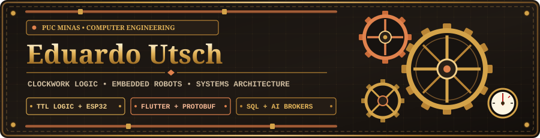

  

  

  
  
  
  

---

### 🚀 Featured Software & Live Interactive Deployments

<table>
  <tr>
    <td width="50%" valign="top">
      <h3>🔭 <a href="https://spherex-lens.pages.dev/">SPHEREx Lens</a></h3>
      
<strong>NASA Space Apps Challenge 2026</strong>

      
Public near-infrared sky explorer built on real <strong>NASA/JPL SPHEREx DR1</strong> data from IRSA. Decodes raw scientific <strong>FITS</strong> binary tables (<code>IMAGE</code>, <code>FLAGS</code>, <code>VARIA</code>, <code>ZODI</code>, <code>EPSF</code>, <code>WAVE</code>) into multi-epoch sky imagery with frame subtraction, cosmic-ray flag filtering, and a <strong>LIFO request queue + MVVM + TDD</strong> frontend.

      

        
      

    </td>
    <td width="50%" valign="top">
      <h3>🗄️ <a href="https://apresentacao-sql.pages.dev/">SQL Under the Hood</a></h3>
      
<strong>Interactive Relational Engine Visualizer</strong>

      
Explore how database storage engines work beneath SQL queries—interactive step-throughs of query execution pipelines, <strong>LRU buffer pools</strong>, <strong>8 KB slotted pages</strong>, null bitmaps, and <strong>SIMD</strong> vectorized execution (bilingual EN / PT-BR).

      

        
      

    </td>
  </tr>
  <tr>
    <td width="50%" valign="top">
      <h3>📡 <a href="https://armageddon-vox.pages.dev/">Armageddon Vox</a></h3>
      
<strong>3-Tier Web Suite & Async Multi-Channel AI Broker</strong>

      
Zero-framework <strong>JavaScript</strong> tactical simulator paired with a <strong>Supabase (PostgreSQL + RLS)</strong> message queue, a local <strong>Node.js + Playwright</strong> multi-LLM daemon, procedural <strong>Web Audio API</strong> synthesis, and <strong>392 automated tests</strong>.

      

        
      

    </td>
    <td width="50%" valign="top">
      <h3>🧗 <a href="https://github.com/aresta-climb/aresta_app">Aresta Climb</a></h3>
      
<strong>Lead Frontend Developer • Production Mobile App</strong>

      
Offline-first climbing guide built with <strong>Flutter/Dart</strong> & <strong>Supabase</strong> (published on App Store & Google Play). Replaced text/YAML payloads with <strong>Protocol Buffers</strong> and <strong>WebP</strong> compression—handling 246+ active climbers and 5,100+ offline route lookups at Festival Igarameca with zero errors.

      

        
      

    </td>
  </tr>
  <tr>
    <td colspan="2" valign="top">
      <h3>🔋 <a href="https://github.com/Ddavidi/hackathon-reply-2026/tree/dev">Real-Time Lithium Battery Vision Pipeline</a> — <em>4th Place Overall (Reply Brasil Hackathon 2026)</em></h3>
      
Real-time <strong>Python / YOLOv11</strong> computer vision detection, integrated object tracking, and multi-class classification pipeline engineered under hackathon time pressure. <a href="https://github.com/Ddavidi/hackathon-reply-2026/tree/dev"><strong>Explore the <code>dev</code> branch →</strong></a>

    </td>
  </tr>
</table>

---

### ⚡ Embedded Systems, Robotics & Pure Digital Logic

<table>
  <tr>
    <td width="50%" valign="top">
      <h4>🤖 App-Dispatched Autonomous Delivery Rover</h4>
      
4WD mobile robot powered by an <strong>ESP32 (<code>ESP-DO</code>)</strong>, <strong>L298N</strong> dual H-bridge motor driver, and front <strong>IR reflectance sensor array</strong>. Follows taped floor tracks between rooms on demand when dispatched by a user via a companion mobile app.

    </td>
    <td width="50%" valign="top">
      <h4>⏱️ Zero-Code 24-Hour Hardware Digital Clock</h4>
      
6-digit (<code>HH:MM:SS</code>) breadboard clock that counts and rolls over cleanly (<code>23:59:59 → 00:00:00</code>) using <strong>purely discrete TTL/CMOS counters, BCD-to-7-segment decoders, and combinational reset logic</strong>—zero microcontroller or software.

    </td>
  </tr>
  <tr>
    <td width="50%" valign="top">
      <h4>🔌 Bare-Metal Microcontroller & Clock Register</h4>
      
Standalone DIP microcontroller wired directly on a breadboard with an external 16 MHz crystal oscillator, load capacitors, reset circuitry, and hardware timing verification.

    </td>
    <td width="50%" valign="top">
      <h4>🏆 Mentorix — <em>Academic Distinction Award (PUC Minas)</em></h4>
      
Award-winning integrated mobile (<strong>Flutter</strong>), web, and hardware campus tutoring platform. Led the persistence migration from <strong>Firebase (NoSQL)</strong> to <strong>Supabase (PostgreSQL)</strong>.

    </td>
  </tr>
</table>

> **Tip:** Convert your two breadboard videos (`20250705_161817.mp4` and `20241205_112540.mp4`) and rover photo into `assets/clock.gif` and `assets/rover.jpg` inside `eduardoutsch/eduardoutsch`—GitHub auto-plays GIFs natively right inside your profile!

---

### 🛠️ Core Stack

  
  
  
  
  
  
  
  
  
  
  
  

---

### 📊 Live GitHub Telemetry

  

---

### 📫 Connect

